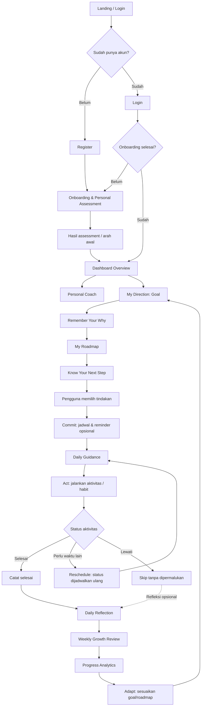

# User Flow PERINTIS

**Versi:** 0.2 — baseline keputusan produk  
**Status:** Keputusan alur utama FIX; detail yang disebut OPEN tetap menunggu keputusan pengguna.

Dokumen ini menjelaskan perjalanan pengguna, bukan detail kode atau database.

## 1. Gambaran besar

## 2. Flow A — Pengguna baru

1. Pengguna membuka aplikasi.
2. Pengguna memilih Register.
3. Sistem memvalidasi data, membuat akun, dan langsung membuat sesi pengguna.
4. Sistem memeriksa status onboarding.
5. Jika belum selesai, pengguna diarahkan ke Onboarding & Personal Assessment; progres dapat disimpan dan dilanjutkan.
6. Pengguna menjawab pertanyaan tentang kondisi, minat, tantangan, dan arah yang ingin dibangun.
7. Sistem menyimpan jawaban dan menampilkan ringkasan/arah awal yang tidak mengklaim sebagai diagnosis.
8. Pengguna masuk ke Dashboard Overview setelah onboarding selesai. Pengguna belum dapat membuat goal sebelum onboarding selesai.

**Hasil:** akun dan data onboarding tersimpan; pengguna dapat memulai goal.

## 3. Flow B — Membuat arah dan tujuan

1. Pengguna membuka My Direction.
2. Pengguna menambahkan goal: judul, deskripsi opsional, kategori bila tersedia, dan target/waktu bila diperlukan.
3. Pengguna menulis Remember Your Why: alasan pribadi dan manfaat yang ingin dicapai.
4. Sistem menyimpan goal dan alasan milik pengguna.
5. Pengguna dapat mengedit atau mengarsipkan goal. Goal tidak dihapus dari antarmuka MVP; arsip mempertahankan roadmap dan histori terkait.

**Hasil:** goal dan alasan personal tersimpan dan tampil di halaman terkait.

## 4. Flow C — Menyusun roadmap dan memilih langkah

1. Pengguna membuka goal.
2. Pengguna membuat satu roadmap aktif untuk goal tersebut.
3. Pengguna menambahkan beberapa langkah kecil dengan urutan yang jelas. Setiap langkah dapat dijadwalkan menjadi beberapa aktivitas.
4. Pengguna membuka Know Your Next Step ketika membutuhkan bantuan menentukan tindakan.
5. Sistem menampilkan 2–4 opsi tindakan yang relevan, atau opsi terstruktur yang telah disiapkan.
6. Pengguna dapat memilih satu opsi, menggabungkan opsi, membuat solusi sendiri, menunda, atau melewati.
7. Pilihan pengguna disimpan sebagai bagian dari rencana. Pengguna sendiri menentukan apakah dan kapan sebuah langkah dijadwalkan sebagai aktivitas.

**Hasil:** roadmap berisi langkah yang dipilih pengguna. Sistem tidak memaksa satu solusi.

## 5. Flow D — Komitmen dan pelaksanaan harian

1. Pengguna memilih langkah/aktivitas yang akan dijalankan.
2. Pengguna menentukan tanggal dan waktu; reminder in-app saat jatuh tempo bersifat opsional. MVP tidak mengirim push/email dan tidak mengintegrasikan kalender eksternal.
3. Pengguna boleh memilih My Commitment atau tidak menggunakannya.
4. Jika memilih konsekuensi, sistem memeriksa bahwa pilihan aman, wajar, sukarela, dapat diedit/dihapus, dan tidak mengganggu kebutuhan dasar.
5. Aktivitas tampil pada Daily Guidance dan Calendar View.
6. Pengguna menandai aktivitas selesai, menjadwalkan ulang, melewati, atau membuka kembali aktivitas selesai/dilewati. Reopen mengubah aktivitas yang sama ke “Belum dimulai”, mempertahankan jadwal, dan mencatat riwayat; tidak membuat duplikasi.
7. Sistem memperbarui status dan ringkasan yang relevan.

**Hasil:** aktivitas harian mengikuti pilihan dan jadwal pengguna.

## 6. Flow E — Habit

1. Pengguna membuka My Habits.
2. Pengguna membuat habit dengan nama dan frekuensi/jadwal yang didukung MVP; mengaitkannya dengan goal bersifat opsional.
3. Habit muncul pada tampilan harian.
4. Pengguna menandai pelaksanaan habit.
5. Sistem menyimpan log per tanggal.
6. Jika tidak dilakukan, sistem tidak mempermalukan pengguna; pengguna dapat melanjutkan sesuai periode berikutnya.

**Hasil:** pengguna dapat melihat catatan habit dari waktu ke waktu.

## 7. Flow F — Refleksi dan adaptasi

1. Pengguna membuka Daily Reflection.
2. Pengguna mengisi refleksi singkat: apa yang berjalan, apa yang sulit, dan apa yang ingin disesuaikan.
3. Sistem menyimpan refleksi.
4. Pengguna membuka Weekly Growth Review untuk melihat ringkasan dinamis Senin–Minggu berdasarkan zona waktu lokal.
5. Sistem menghitung jumlah aktivitas terjadwal/selesai/dilewati, log habit, dan refleksi; jika data kurang, sistem menjelaskan keterbatasannya. Tidak ada skor.
6. Pengguna meninjau perkembangan dan menentukan penyesuaian.
7. Pengguna dapat menyesuaikan goal, roadmap, atau langkah berikutnya.

**Hasil:** siklus Understand → Explore → Choose → Commit → Act → Reflect → Adapt berulang.

## 8. Flow G — Pengguna kembali setelah terlewat

1. Pengguna membuka aplikasi setelah tidak menjalankan aktivitas.
2. Sistem menampilkan status secara netral.
3. Pengguna memilih reschedule, revise, atau skip. Reschedule mengubah jadwal dan menandai status “Dijadwalkan ulang”.
4. Refleksi setelah skip bersifat opsional.
5. Jika ada My Commitment, pengguna meninjau sendiri pilihannya; tidak ada hukuman otomatis.
6. Pengguna dapat membuka panduan Coach terstruktur yang sesuai dengan tantangan dan memilih langkah baru.
7. Pengguna menentukan tindakan selanjutnya.

**Hasil:** pengguna dapat memulai kembali tanpa rasa malu.

## 9. Flow Personal Coach

1. Pengguna membuka Personal Coach.
2. Pengguna memilih topik/skenario terkurasi untuk mendapatkan panduan.
3. Coach menampilkan materi dan prompt terstruktur yang telah disiapkan; bukan respons AI live.
4. Jika menyarankan tindakan, Coach menawarkan beberapa opsi konkret.
5. Pengguna bebas memilih, menggabungkan, membuat opsi sendiri, menunda, atau melewati.
6. Coach tidak menyimpan riwayat percakapan; pilihan yang menjadi rencana disimpan sebagai roadmap step/activity.

Interaksi ini ditetapkan pada DEC-029; tidak ada input chat bebas, AI live, atau penyimpanan riwayat.

## 10. Flow Profile & Settings

- Pengguna membuka Profile & Settings.
- Pengguna memperbarui informasi profil dan preferensi.
- Pengguna memilih tema Dark (default) atau Light.
- Pengguna mengelola reminder in-app opsional; notifikasi jatuh tempo diperiksa saat aplikasi dibuka, bukan dikirim real-time saat aplikasi tertutup.
- Pengguna logout.

## 11. Kondisi tepi yang harus diperhatikan

- Pengguna belum menyelesaikan onboarding.
- Form kosong atau tidak valid.
- Pengguna mencoba membuka data milik user lain.
- Goal tidak memiliki roadmap.
- Aktivitas selesai/dilewati dibuka kembali ke status belum dimulai dengan jadwal tetap dan riwayat status.
- Aktivitas di-reschedule beberapa kali.
- Pengguna memilih skip.
- Tidak ada data untuk weekly review atau analytics.
- Panduan Coach atau notifikasi jatuh tempo belum tersedia/dikonfigurasi.
- Pengguna mengarsipkan goal yang masih memiliki roadmap/aktivitas; seluruh histori tetap dipertahankan.
- Zona waktu lokal perangkat berbeda dari zona waktu server; tanggal kalender dan ringkasan menggunakan zona waktu lokal perangkat.

## 12. Keputusan yang telah disetujui dan hal yang masih terbuka

Keputusan alur yang disetujui:
- Register langsung membuat sesi; onboarding dapat disimpan/dilanjutkan dan harus selesai sebelum pengguna membuat goal.
- Satu roadmap aktif per goal; satu langkah dapat dijadwalkan menjadi beberapa aktivitas.
- Habit dapat berdiri sendiri atau dikaitkan ke goal.
- Status aktivitas mencakup belum dimulai, sedang berjalan, selesai, dijadwalkan ulang, dan dilewati. Reschedule memperbarui jadwal dan status.
- Refleksi setelah skip bersifat opsional.
- Coach menggunakan panduan terstruktur tanpa riwayat percakapan tersimpan.
- Reminder terbatas pada notifikasi in-app saat jatuh tempo.
- Reminder due diperiksa saat aplikasi dibuka (DEC-033).
- Weekly Review dan Analytics memakai pekan Senin–Minggu lokal dengan hitungan aktivitas terjadwal/selesai/dilewati, log habit, dan refleksi; tanpa skor (DEC-032).
- Goal hanya dapat diarsipkan; histori turunannya dipertahankan.
- Theme Customization menyediakan toggle Dark/Light dengan Dark sebagai default (DEC-035).
- Untuk demo, ekspor dan UI hapus akun tidak tersedia; permintaan penghapusan diproses manual (DEC-030).

Keputusan/validasi yang masih OPEN:
- Kebijakan retensi sebelum rilis publik.
- Matriks transisi status aktivitas selain reopen selesai/dilewati (OPEN-014).
- Cara memperoleh/menyimpan zona waktu IANA untuk kalkulasi lokal.
- Apakah My Commitment boleh generik atau wajib terkait Goal/Activity.
- Status Roadmap Step yang dipakai sementara pada schema development masih PROPOSED (OPEN-024); konfirmasi sebelum schema final/provisioning. Field onboarding/reflection difinalkan pada task UI terkait.
- Verifikasi ketersediaan region Supabase Singapore saat provisioning.

Rekomendasi desain Stitch disetujui sebagai acuan implementasi (DEC-027); mockup tetap statis, bukan UI aplikasi yang sudah berjalan.
