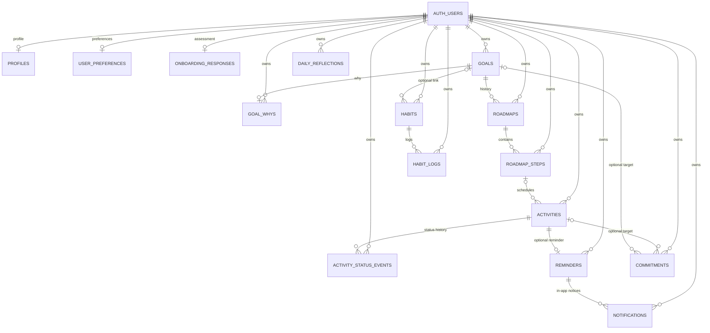

# PERINTIS — ERD Database Design

**Status:** Rancangan untuk review; bukan persetujuan schema final, Prisma models, atau migration.  
**Sumber:** PRD, User Flow, Functional Specification, scope MVP, DEC-001–040, baseline ERD DEC-028, dan migration Supabase lokal yang ada. Tidak ada database introspection dalam penyusunan dokumen ini.

## 1. Batas rancangan

- Mencakup 19 fitur MVP tanpa menambah fitur atau menyimpan data yang tidak diperlukan.
- `auth.users` tetap dikelola Supabase Auth. Akun/password tidak diduplikasi ke tabel aplikasi.
- Migration lokal yang diperiksa sudah mendefinisikan 15 tabel aplikasi di bawah. Ini adalah pemeriksaan file, bukan bukti schema remote sama atau sudah diterapkan.
- Weekly Growth Review, Progress Analytics, Dashboard Overview, dan Calendar adalah agregasi dari data transaksi; tidak perlu tabel snapshot/duplikasi.
- Structured Coach menggunakan data domain PERINTIS yang ada. Wise Personal Growth Mentor menyimpan riwayat pada tabel percakapan/pesan aplikasi yang sudah tersedia; keputusan ini tidak mengubah schema. Pilihan Know Your Next Step tidak disimpan sebagai sesi terpisah; pilihan yang menjadi rencana disimpan sebagai roadmap step/activity.
- Semua rekomendasi di dokumen ini berstatus **PROPOSED** kecuali dinyatakan sebagai keputusan **FIX** atau **OPEN** di Decision Log.

## 2. ERD

`AUTH_USERS` merujuk `auth.users`, tabel eksternal yang dikelola Supabase. Hubungan `COMMITMENTS` ke Goal dan Activity bersifat opsional; aturan akhir tetap OPEN-023.

## 3. Tabel, kolom, dan aturan yang direkomendasikan

Semua ID entitas aplikasi adalah `uuid` dengan `gen_random_uuid()` kecuali `user_id`; waktu absolut menggunakan `timestamptz` UTC. `created_at` umumnya `NOT NULL DEFAULT now()`. Kolom dan constraint berikut merangkum migration lokal yang ada serta hal yang perlu disetujui sebelum schema final.

| Tabel | Kolom utama (tipe; nullable/default) | Kunci dan constraint penting |
|---|---|---|
| `profiles` | `user_id uuid NOT NULL`; `full_name text NOT NULL`; `avatar_url text NULL`; `created_at`, `updated_at timestamptz NOT NULL DEFAULT now()` | PK `user_id`; FK ke `auth.users(id) ON DELETE CASCADE`. Email tetap di Auth. |
| `user_preferences` | `user_id uuid NOT NULL`; `timezone text NULL`; `theme text NOT NULL DEFAULT 'dark'`; `reminder_enabled boolean NOT NULL DEFAULT false`; `updated_at timestamptz NOT NULL DEFAULT now()` | PK/FK `user_id`; `CHECK theme IN ('dark','light')` (DEC-035). Makna `timezone` dan flag reminder masih perlu ditinjau. |
| `onboarding_responses` | `user_id uuid NOT NULL`; `answers jsonb NOT NULL DEFAULT '{}'`; `completed_at timestamptz NULL`; `updated_at timestamptz NOT NULL DEFAULT now()` | PK/FK `user_id`; `CHECK jsonb_typeof(answers) = 'object'`. Dapat menyimpan progres sebelum selesai. Bentuk jawaban final OPEN. |
| `goals` | `id uuid NOT NULL DEFAULT gen_random_uuid()`; `user_id uuid NOT NULL`; `title text NOT NULL`; `description text NULL`; `category text NULL`; `target_date date NULL`; `status text NOT NULL DEFAULT 'active'`; `archived_at timestamptz NULL`; timestamps | PK `id`; `UNIQUE(id,user_id)` untuk FK komposit; status `active/archived`; validasi judul nonkosong. Goal diarsipkan, bukan dihapus dari UI (DEC-023). |
| `goal_whys` | `id uuid NOT NULL DEFAULT gen_random_uuid()`; `goal_id`, `user_id uuid NOT NULL`; `statement text NOT NULL`; timestamps | PK `id`; `UNIQUE(id,user_id)` opsional bila dibutuhkan sebagai target FK; `UNIQUE(goal_id)` pada baseline (maksimum satu Why per Goal); FK `(goal_id,user_id)` ke Goal. Bentuk satu Why vs riwayat/versi perlu review bila kebutuhan muncul. |
| `roadmaps` | `id uuid NOT NULL DEFAULT gen_random_uuid()`; `goal_id`, `user_id uuid NOT NULL`; `title text NULL`; `status text NOT NULL DEFAULT 'active'`; timestamps | PK `id`; `UNIQUE(id,user_id)`; FK `(goal_id,user_id)`; unique partial index pada `goal_id WHERE status='active'` (maksimum satu roadmap aktif per Goal, DEC-017). |
| `roadmap_steps` | `id uuid NOT NULL DEFAULT gen_random_uuid()`; `roadmap_id`, `user_id uuid NOT NULL`; `title text NOT NULL`; `description text NULL`; `position integer NOT NULL`; `status text NOT NULL`; timestamps | PK `id`; `UNIQUE(id,user_id)`; `UNIQUE(roadmap_id,position)`; FK `(roadmap_id,user_id)`; `CHECK position >= 0`. Daftar status masih OPEN-024; migration lokal memakai proposal `not_started/in_progress/completed`. |
| `activities` | `id uuid NOT NULL DEFAULT gen_random_uuid()`; `user_id uuid NOT NULL`; `roadmap_step_id uuid NULL`; `title text NOT NULL`; `description text NULL`; `scheduled_at timestamptz NULL`; `status text NOT NULL DEFAULT 'not_started'`; `completed_at timestamptz NULL`; timestamps | PK `id`; `UNIQUE(id,user_id)`; FK `(roadmap_step_id,user_id)` ke Step; status dari DEC-018; aksi reopen dan pencatatan mengikuti DEC-031. Matriks transisi lainnya OPEN-014. |
| `activity_status_events` | `id uuid NOT NULL DEFAULT gen_random_uuid()`; `activity_id`, `user_id uuid NOT NULL`; `from_status` nullable; `to_status` NOT NULL; `previous_scheduled_at`, `new_scheduled_at timestamptz NULL`; `created_at timestamptz NOT NULL DEFAULT now()` | PK `id`; FK `(activity_id,user_id)` ke Activity; CHECK status; append-only untuk authenticated role. Perubahan aktivitas dan event sebaiknya satu transaksi. |
| `habits` | `id uuid NOT NULL DEFAULT gen_random_uuid()`; `user_id uuid NOT NULL`; `goal_id uuid NULL`; `name text NOT NULL`; `description text NULL`; `schedule jsonb NOT NULL DEFAULT '{}'`; `is_active boolean NOT NULL DEFAULT true`; timestamps | PK `id`; `UNIQUE(id,user_id)`; FK `(goal_id,user_id)` opsional sesuai DEC-019; `CHECK jsonb_typeof(schedule)='object'`. Struktur jadwal Habit belum difinalkan. |
| `habit_logs` | `id uuid NOT NULL DEFAULT gen_random_uuid()`; `habit_id`, `user_id uuid NOT NULL`; `log_date date NOT NULL`; `note text NULL`; `created_at timestamptz NOT NULL DEFAULT now()` | PK `id`; `UNIQUE(habit_id,log_date)`; FK `(habit_id,user_id)` ke Habit. Satu log per habit per tanggal; tanggal lokal perlu menggunakan zona waktu pengguna. |
| `reminders` | `id uuid NOT NULL DEFAULT gen_random_uuid()`; `activity_id`, `user_id uuid NOT NULL`; `remind_at timestamptz NOT NULL`; `is_enabled boolean NOT NULL DEFAULT true`; timestamps | PK `id`; `UNIQUE(activity_id)` (maksimum satu reminder per aktivitas sebagai penyederhanaan); `UNIQUE(id,user_id)`; FK `(activity_id,user_id)` ke Activity. Reminder in-app, due check saat aplikasi dibuka (DEC-021/033). |
| `notifications` | `id uuid NOT NULL DEFAULT gen_random_uuid()`; `user_id`, `reminder_id uuid NOT NULL`; `scheduled_for timestamptz NOT NULL`; `title text NOT NULL`; `body text NULL`; `read_at timestamptz NULL`; `created_at timestamptz NOT NULL DEFAULT now()` | PK `id`; `UNIQUE(reminder_id,scheduled_for)` mencegah duplikasi; FK `(reminder_id,user_id)` ke Reminder. Tidak menyatakan pengiriman push/email. |
| `daily_reflections` | `id uuid NOT NULL DEFAULT gen_random_uuid()`; `user_id uuid NOT NULL`; `reflection_date date NOT NULL`; `answers jsonb NOT NULL DEFAULT '{}'`; timestamps | PK `id`; `UNIQUE(user_id,reflection_date)`; `CHECK jsonb_typeof(answers)='object'`. Satu refleksi per tanggal; struktur prompt/answers final OPEN. |
| `commitments` | `id uuid NOT NULL DEFAULT gen_random_uuid()`; `user_id uuid NOT NULL`; `activity_id uuid NULL`; `goal_id uuid NULL`; `description text NOT NULL`; `is_active boolean NOT NULL DEFAULT true`; timestamps | PK `id`; `UNIQUE(id,user_id)`; FK komposit opsional ke Activity/Goal; CHECK tidak mengisi kedua target sekaligus pada baseline. Apakah target keduanya boleh NULL masih OPEN-023. Tidak ada eksekusi hukuman otomatis. |

### Entitas yang sengaja tidak dibuat

- `auth.users` tidak diduplikasi dan tidak dikelola Prisma.
- Riwayat Wise Personal Growth Mentor memakai tabel aplikasi yang sudah ada; tidak ada tabel baru yang ditambahkan oleh DEC-040.
- Tidak ada tabel Next Step session/options; simpan hanya step/activity yang dipilih menjadi rencana.
- Tidak ada tabel Dashboard, Weekly Review, Analytics, atau Calendar; query/agregasi memakai tabel transaksi dan zona waktu pengguna (DEC-022).
- Tidak ada tabel terpisah untuk reschedule; Activity diperbarui dan perubahan ditulis ke `activity_status_events`.

## 4. Foreign key, kardinalitas, dan penghapusan

| Relasi | Kardinalitas | FK yang direkomendasikan | Penghapusan |
|---|---|---|---|
| Auth user → profile/preferences/onboarding | 1:0..1 masing-masing | `user_id → auth.users.id` | `ON DELETE CASCADE` untuk purge akun administratif; bukan aksi UI MVP. |
| Auth user → setiap data transaksi | 1:N | `user_id → auth.users.id` | `ON DELETE CASCADE` untuk purge akun. |
| Goal → Why | 1:0..1 | `(goal_id,user_id) → goals(id,user_id)` | Cascade saat Goal benar-benar dihapus administratif; Goal diarsipkan di UI. |
| Goal → Roadmaps | 1:N histori; maksimal satu aktif | `(goal_id,user_id)` | Cascade purge administratif; histori dipertahankan selama arsip Goal. |
| Roadmap → Steps | 1:N | `(roadmap_id,user_id)` | Cascade. |
| Step → Activities | 1:N; Activity boleh tanpa Step | `(roadmap_step_id,user_id)` nullable | Cascade dari Step jika dihapus administratif; sebelum itu, perlu menjaga histori atau memilih restrict/set-null sesuai aturan product yang ditinjau. Baseline migration saat ini menggunakan cascade. |
| Activity → Status events | 1:N | `(activity_id,user_id)` | Cascade hanya pada purge/penghapusan administratif; event tidak dapat diedit/dihapus oleh authenticated role. |
| Goal → Habits | 1:N opsional | `(goal_id,user_id)` nullable | Cascade jika Goal hard-delete administratif; di UI Goal diarsipkan. Habit sendiri dinonaktifkan untuk mempertahankan log. |
| Habit → Logs | 1:N | `(habit_id,user_id)` | Cascade hanya pada purge; soft-disable Habit untuk mempertahankan histori. |
| Activity → Reminder | 1:0..1 | `(activity_id,user_id)` | Cascade. Batas satu reminder adalah penyederhanaan yang disetujui pada baseline, dapat ditinjau bila kebutuhan berubah. |
| Reminder → Notifications | 1:N | `(reminder_id,user_id)` | Cascade. |
| Auth user → Reflections/Commitments | 1:N | `user_id → auth.users.id` | Cascade pada purge administratif. Reflection dan Commitment tidak dihapus otomatis karena status aktivitas berubah. |
| Goal/Activity → Commitment | masing-masing 1:N opsional | FK komposit dan `user_id` yang sama | Cascade administratif; perilaku target masih OPEN-023. |

### Foreign key komposit

Untuk setiap relasi antar data privat, gunakan `UNIQUE(parent.id,parent.user_id)` dan FK `(child.parent_id,child.user_id) → parent(id,user_id)`. Ini menolak hubungan lintas user walaupun aplikasi salah memasangkan UUID. Relasi yang direkomendasikan: Goal→Why/Roadmap/Habit/Commitment; Roadmap→Step; Step→Activity; Activity→Event/Reminder/Commitment; Habit→Log; Reminder→Notification.

## 5. Index dan constraint

### Constraint penting

- PK UUID di setiap entitas aplikasi; PK `user_id` untuk profil, preferensi, onboarding.
- FK `user_id` ke Auth dan FK komposit untuk seluruh parent-child privat.
- Partial unique index `roadmaps(goal_id) WHERE status='active'`.
- Unique `roadmap_steps(roadmap_id,position)`, `habit_logs(habit_id,log_date)`, `daily_reflections(user_id,reflection_date)`, `reminders(activity_id)`, `notifications(reminder_id,scheduled_for)`.
- CHECK untuk string wajib nonkosong, status terbatas, `position >= 0`, tema, tipe JSON object, dan maksimal satu target Commitment.
- Tidak memberi hak DELETE ke client untuk archive-only domain. Retensi/purge akun mengikuti DEC-030 dan OPEN-013.

### Index query utama

Baseline migration lokal sudah membuat indeks berikut; sesuaikan melalui pengukuran query sebelum menambah indeks lain:

| Index pattern | Kegunaan |
|---|---|
| `goals(user_id,status)` | Goal aktif/arsip pengguna. |
| `roadmaps(goal_id,user_id)` dan `roadmap_steps(roadmap_id,user_id)` | Hierarki Goal→Roadmap→Step. |
| `activities(user_id,status)`, `(user_id,scheduled_at)`, `(roadmap_step_id,user_id)` | Dashboard, planner/calendar, dan daftar aktivitas per Step. |
| `activity_status_events(user_id)`, `(activity_id)` | Histori pengguna dan satu aktivitas. |
| `habits(user_id)`, `(goal_id,user_id)`; `habit_logs(user_id,log_date)`, `(habit_id,user_id)` | Daftar Habit dan agregasi harian/mingguan. |
| `reminders(user_id,remind_at,is_enabled)` | Pencarian reminder yang jatuh tempo. |
| `notifications(user_id,created_at DESC)`, `(reminder_id,user_id)` | Inbox dan deduplikasi notifikasi. |
| `daily_reflections(user_id,reflection_date)` | Refleksi per tanggal dan agregasi mingguan. |
| `commitments(user_id)`, `(activity_id,user_id)`, `(goal_id,user_id)` | Daftar dan target Commitment. |

PK/unique constraint sudah menghasilkan beberapa indeks. Sebelum menambah indeks duplikat, verifikasi query plan dan selectivity setelah implementasi; indeks menambah biaya tulis dan penyimpanan.

## 6. Pemetaan fitur → data

| Fitur MVP | Sumber data |
|---|---|
| Authentication | Supabase Auth `auth.users`; tidak ada tabel credential aplikasi. |
| Profile & Settings, Theme Customization | `profiles`, `user_preferences`. |
| Onboarding & Assessment | `onboarding_responses`. |
| Dashboard Overview | Agregasi `goals`, `roadmap_steps`, `activities`, `habits`, `habit_logs`, `goal_whys`; bukan tabel dashboard. |
| Personal Coach | Structured Coach memakai data domain; Wise Personal Growth Mentor menggunakan `assistant_conversations` dan `assistant_messages` yang sudah ada (DEC-040). |
| My Direction | `goals`. |
| Remember Your Why | `goal_whys`. |
| My Roadmap | `roadmaps`, `roadmap_steps`. |
| Know Your Next Step | Opsi ditampilkan tanpa sesi tersimpan; hasil pilihan menjadi `roadmap_steps` atau `activities`. |
| Daily Guidance; Task Reschedule / Skip | `activities`, `activity_status_events`. |
| My Habits | `habits`, `habit_logs`. |
| Reminder & Notification | `user_preferences` (bila flag global dipertahankan), `reminders`, `notifications`. |
| Daily Reflection | `daily_reflections`. |
| Weekly Growth Review; Progress Analytics | Query agregasi dari activity, habit logs, reflections, dan goals; tidak ada snapshot. |
| My Commitment | `commitments`. |
| Calendar View | Agregasi Activity dan jadwal Habit; tidak ada tabel calendar. |

## 7. Alur contoh: Goal sampai Reflection

1. Supabase Auth membuat `auth.users`; trigger lokal saat ini membuat `profiles` dan `user_preferences`.
2. Jawaban assessment disimpan/upsert ke `onboarding_responses`; `completed_at` diisi saat selesai.
3. Pengguna membuat `goals` dengan `user_id` dari sesi terverifikasi, lalu menulis `goal_whys`.
4. Pengguna membuat `roadmaps` dengan status aktif dan menyusun `roadmap_steps` berurutan.
5. Setelah memilih tindakan, aktivitas dijadwalkan sebagai `activities` dan opsional `reminders`.
6. Selesai/reschedule/skip memperbarui baris Activity yang sama dan menambah `activity_status_events` secara atomik. Reopen mempertahankan ID dan jadwal (DEC-031).
7. Refleksi hari itu di-upsert pada `(user_id,reflection_date)` dalam `daily_reflections`.
8. Weekly Review menghitung agregat activity, habit logs, dan reflection untuk pekan Senin–Minggu pada zona waktu pengguna; tidak membuat row ringkasan.

## 8. Kecocokan dengan PostgreSQL, Supabase, dan Prisma 7

### PostgreSQL / Supabase

- UUID, `timestamptz`, `date`, JSONB, CHECK, partial unique index, composite FK, dan RLS sesuai dengan kemampuan PostgreSQL.
- Supabase Auth menyediakan `auth.users` dan `auth.uid()` untuk ownership policy.
- Semua tabel aplikasi privat berada di schema `public` pada migration lokal; baseline mengaktifkan RLS pada 15 tabel, mencabut akses `anon/authenticated` secara luas lalu memberi grants selektif dan policy owner-scoped.
- RLS tidak mengganti validasi server atau FK. Policy ownership saja tidak memvalidasi transisi status, dan user dengan akses `INSERT` ke event masih dapat memasukkan histori yang tidak sesuai jika alur aplikasi tidak memvalidasi.
- Tidak ada klaim bahwa migration lokal sudah diterapkan pada remote. Konektivitas `SELECT 1` tidak memverifikasi kesamaan schema.

### Prisma 7

- Prisma 7 mendukung PostgreSQL dan konfigurasi datasource melalui `prisma7.config.ts`; URL tidak lagi perlu ditaruh dalam datasource block schema untuk setup saat ini.
- Model yang kelak dibuat dapat merepresentasikan tabel, tipe scalar, relasi/composite key, unique/index dasar, dan JSON fields. UUID/default DB, array/JSON semantics, dan nama tabel/kolom perlu ditetapkan eksplisit.
- `auth.users` adalah tabel Supabase yang dikelola eksternal; jangan membuatnya atau mengubah ownership/password lewat Prisma.
- Partial unique index, policies RLS, trigger, grants, dan fungsi perlu tetap dikelola melalui SQL migration Supabase. Jangan menganggap Prisma schema sebagai deskripsi lengkap security boundary PostgreSQL.
- Prisma Client yang tersambung sebagai role database privileged tidak otomatis membawa JWT sesi Supabase ke PostgreSQL dan dapat melewati RLS. Karena itu model/Client tidak boleh dipakai untuk data privat sebelum strategi role/JWT/transaction-local claims dan connection pooling ditinjau serta diuji.
- **Rekomendasi:** gunakan Supabase Auth + Supabase SDK untuk operasi data pengguna MVP yang bergantung pada JWT/RLS. Gunakan Prisma hanya untuk pengembangan schema tooling setelah ditinjau, sambil mempertahankan migration SQL sebagai sumber schema.

## 9. FIX, PROPOSED, dan OPEN

### Keputusan FIX yang menjadi dasar

- DEC-016: onboarding dapat dilanjutkan; selesai sebelum Goal dibuat.
- DEC-017/018/019/023/031: maksimal satu roadmap aktif per Goal; satu Step dapat menghasilkan banyak Activity; status Activity; Habit dapat berdiri sendiri; Goal diarsipkan; reopen memakai Activity sama dan tercatat.
- DEC-020/029 adalah keputusan historis yang superseded oleh DEC-040: Structured Coach dan Wise Personal Growth Mentor berjalan berdampingan; riwayat Mentor disimpan pada tabel aplikasi yang sudah ada.
- DEC-021/033: reminder in-app saja, due check saat aplikasi dibuka.
- DEC-022/032: weekly dan analytics dihitung dari data aktual Senin–Minggu lokal, hitungan tanpa skor.
- DEC-030: tidak ada UI hapus akun; purge administratif untuk demo, retensi publik tetap OPEN.
- DEC-035: tema dark default/light disimpan pada preferensi.
- DEC-037/038: Prisma 7 untuk schema tooling; pooler Singapore; penggunaan Prisma untuk query privat dan strategi migrasi tetap OPEN.

### Rekomendasi PROPOSED

- Pertahankan 15 tabel aplikasi pada baseline migration, dengan view/query agregasi untuk dashboard, weekly review, analytics, dan calendar.
- Pertahankan FK komposit untuk seluruh relasi privat serta soft archive/disable daripada delete pada Goal/Habit.
- Pilih satu Why per Goal dan satu Reminder per Activity sebagai batas MVP selama belum ada kebutuhan lain.
- Pertahankan SQL migration sebagai source of truth untuk RLS, trigger, partial index, dan grants; Prisma Client bukan jalur akses data user pada MVP awal.
- Tentukan satu aturan makna untuk `user_preferences.reminder_enabled` bersama `reminders.is_enabled`; dua tingkat toggle hanya bila global master-disable memang diinginkan.

### Keputusan OPEN yang memengaruhi desain final

- OPEN-013: retensi data sebelum rilis publik dan prosedur purge.
- OPEN-014: matriks transisi Activity selain reopen; validasi event konsisten dengan status.
- OPEN-019: tooling tambahan tetap OPEN; task ini tidak menambah dependency.
- OPEN-022: apakah timezone IANA disimpan otomatis atau hanya dipakai per request; memengaruhi semantik tanggal, agregasi pekanan, refleksi, dan habit log.
- OPEN-023: Commitment boleh tanpa target atau harus mengacu ke Goal/Activity.
- OPEN-024: status Roadmap Step; struktur field onboarding/reflection juga menunggu task UI terkait.
- Perlu persetujuan untuk struktur final JSONB onboarding, habit schedule, reflection, serta apakah Why perlu histori.
- Perlu keputusan strategi schema ownership Prisma vs Supabase SQL, dan strategi autentikasi/role/RLS sebelum Prisma Client query privat.

Tidak ada item OPEN di atas yang diputuskan oleh dokumen ini.
