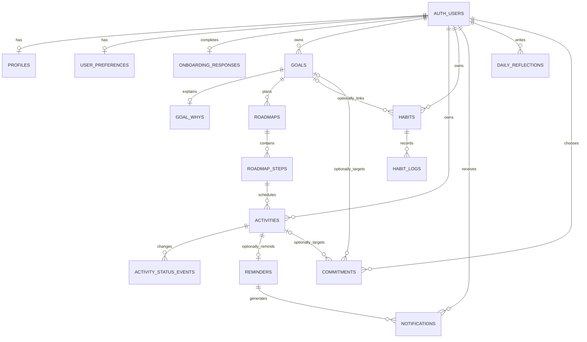

# ERD Proposal — PERINTIS MVP

**Status:** Disetujui pengguna sebagai baseline ERD konseptual (DEC-028); bukan schema final, SQL, atau izin migration. Keputusan yang tetap OPEN tercantum di bagian 7.  
**Dasar:** keputusan FIX pada `docs/15-DECISION-LOG.md` dan flow/spec versi 0.2, diperbarui oleh DEC-040.

## 1. Prinsip rancangan

- `auth.users` milik Supabase Auth menjadi sumber akun; jangan membuat ulang tabel password/user-auth.
- Semua data privat membawa `user_id` yang mengacu ke `auth.users.id`, dan setiap query tetap memakai sesi terautentikasi serta RLS.
- Foreign key komposit `(id, user_id)` menjaga relasi anak tidak dapat menunjuk data milik user lain.
- Weekly Review, Progress Analytics, dan Calendar adalah hasil hitung/agregasi dari data transaksi; tidak dibuat tabel snapshot/duplikasi.
- Structured Coach menggunakan data domain yang sudah ada; Wise Personal Growth Mentor memakai tabel percakapan/pesan yang sudah ada sesuai DEC-040. Opsi Next Step yang belum dipilih bersifat sementara; pilihan yang menjadi rencana disimpan sebagai roadmap step/activity.
- Status aktivitas mengikuti DEC-018/DEC-031. Riwayat status append-only mencatat reschedule dan reopen; aktivitas selesai/dilewati yang dibuka kembali memakai ID yang sama.

## 2. Diagram konseptual

`AUTH_USERS` adalah tabel eksternal yang dikelola Supabase Auth, bukan tabel aplikasi buatan proyek.

## 3. Entitas dan kolom utama

Semua ID aplikasi adalah `uuid` dengan default `gen_random_uuid()` kecuali dinyatakan sebagai FK/PK yang memakai ID Supabase. Timestamp memakai `timestamptz` UTC; tanggal refleksi/log adalah `date` pada zona waktu pengguna. Kolom `created_at` umumnya `NOT NULL DEFAULT now()`.

| Entitas | Kolom utama dan aturan |
|---|---|
| `profiles` | `user_id uuid PK/FK auth.users.id`; `full_name text NOT NULL`; `avatar_url text NULL`; `created_at`, `updated_at` `timestamptz NOT NULL`. Email tetap dikelola Auth. |
| `user_preferences` | `user_id uuid PK/FK`; `timezone text NULL` (IANA; penyimpanan otomatis dari browser masih PROP-001/OPEN-022); `theme text NOT NULL DEFAULT 'dark' CHECK(theme IN ('dark','light'))` (DEC-035); `reminder_enabled boolean NOT NULL DEFAULT false`; `updated_at timestamptz NOT NULL`. |
| `onboarding_responses` | `user_id uuid PK/FK`; `answers jsonb NOT NULL DEFAULT '{}'`; `completed_at timestamptz NULL`; `updated_at timestamptz NOT NULL`. |
| `goals` | `id uuid PK`; `user_id uuid FK`; `title text NOT NULL`; `description text NULL`; `category text NULL`; `target_date date NULL`; `status text NOT NULL DEFAULT 'active'`; `archived_at timestamptz NULL`; `created_at`, `updated_at`. `UNIQUE(id,user_id)` untuk FK komposit. Daftar status Goal masih perlu disepakati bila lebih dari active/archived diperlukan. |
| `goal_whys` | `id uuid PK`; `goal_id uuid NOT NULL`; `user_id uuid NOT NULL`; `statement text NOT NULL`; `created_at`, `updated_at`. `UNIQUE(goal_id)` dan FK `(goal_id,user_id)` ke goals. Satu alasan aktif per goal adalah usulan minimum. |
| `roadmaps` | `id uuid PK`; `goal_id uuid NOT NULL`; `user_id uuid NOT NULL`; `title text NULL`; `status text NOT NULL DEFAULT 'active'`; `created_at`, `updated_at`; `UNIQUE(id,user_id)`. Unique partial index pada `goal_id WHERE status='active'` memastikan maksimal satu roadmap aktif per goal. |
| `roadmap_steps` | `id uuid PK`; `roadmap_id uuid NOT NULL`; `user_id uuid NOT NULL`; `title text NOT NULL`; `description text NULL`; `position integer NOT NULL CHECK(position >= 0)`; `status text NOT NULL`; `created_at`, `updated_at`; `UNIQUE(id,user_id)` dan `UNIQUE(roadmap_id,position)`. Status migration development memakai usulan PROP-003 (`not_started`, `in_progress`, `completed`); tetap OPEN-024. |
| `activities` | `id uuid PK`; `user_id uuid NOT NULL`; `roadmap_step_id uuid NULL`; `title text NOT NULL`; `description text NULL`; `scheduled_at timestamptz NULL`; `status text NOT NULL DEFAULT 'not_started' CHECK(status IN ('not_started','in_progress','completed','rescheduled','skipped'))`; `completed_at timestamptz NULL`; `created_at`, `updated_at`; `UNIQUE(id,user_id)`. `scheduled_at` NULL mendukung tindakan yang belum dijadwalkan. |
| `activity_status_events` | `id uuid PK`; `activity_id uuid NOT NULL`; `user_id uuid NOT NULL`; `from_status text NULL`; `to_status text NOT NULL`; `previous_scheduled_at timestamptz NULL`; `new_scheduled_at timestamptz NULL`; `created_at timestamptz NOT NULL`. Append-only untuk jejak reschedule/status/reopen (DEC-031). |
| `habits` | `id uuid PK`; `user_id uuid NOT NULL`; `goal_id uuid NULL`; `name text NOT NULL`; `description text NULL`; `schedule jsonb NOT NULL DEFAULT '{}'`; `is_active boolean NOT NULL DEFAULT true`; `created_at`, `updated_at`; `UNIQUE(id,user_id)`. `goal_id` opsional sesuai DEC-019. Bentuk frekuensi perlu disederhanakan saat finalisasi scope. |
| `habit_logs` | `id uuid PK`; `habit_id uuid NOT NULL`; `user_id uuid NOT NULL`; `log_date date NOT NULL`; `note text NULL`; `created_at timestamptz NOT NULL`; `UNIQUE(habit_id,log_date)` mencegah duplikasi log harian. |
| `reminders` | `id uuid PK`; `activity_id uuid NOT NULL UNIQUE`; `user_id uuid NOT NULL`; `remind_at timestamptz NOT NULL`; `is_enabled boolean NOT NULL DEFAULT true`; `created_at`, `updated_at`; `UNIQUE(id,user_id)`. Tidak menyatakan bahwa notifikasi sudah terkirim. |
| `notifications` | `id uuid PK`; `user_id uuid NOT NULL`; `reminder_id uuid NOT NULL`; `scheduled_for timestamptz NOT NULL`; `title text NOT NULL`; `body text NULL`; `read_at timestamptz NULL`; `created_at timestamptz NOT NULL`. Unique `(reminder_id,scheduled_for)` mencegah duplikasi hasil trigger. Hanya notifikasi in-app; tidak ada delivery push/email. |
| `daily_reflections` | `id uuid PK`; `user_id uuid NOT NULL`; `reflection_date date NOT NULL`; `answers jsonb NOT NULL DEFAULT '{}'`; `created_at`, `updated_at`; `UNIQUE(user_id,reflection_date)` untuk satu refleksi per tanggal. Pertanyaan final mengikuti desain yang disetujui. |
| `commitments` | `id uuid PK`; `user_id uuid NOT NULL`; `activity_id uuid NULL`; `goal_id uuid NULL`; `description text NOT NULL`; `is_active boolean NOT NULL DEFAULT true`; `created_at`, `updated_at`; `UNIQUE(id,user_id)`. Migration development memakai usulan PROP-002: CHECK melarang target activity dan goal sekaligus, tetapi keduanya boleh NULL. OPEN-023 tetap berlaku; tidak ada eksekusi otomatis. |

## 4. Foreign key, unique, index, dan penghapusan

- Semua `user_id` merujuk `auth.users(id) ON DELETE CASCADE` untuk proses purge akun yang kelak disetujui. Gunakan FK komposit `(parent_id,user_id)` ke parent `(id,user_id)` untuk relasi privat berikut: `goal_whys.goal_id → goals`, `roadmaps.goal_id → goals`, `roadmap_steps.roadmap_id → roadmaps`, `activities.roadmap_step_id → roadmap_steps`, `activity_status_events.activity_id → activities`, `habits.goal_id → goals`, `habit_logs.habit_id → habits`, `reminders.activity_id → activities`, `notifications.reminder_id → reminders`, `commitments.activity_id → activities`, dan `commitments.goal_id → goals`. Parent yang dirujuk harus memiliki `UNIQUE(id,user_id)`; aktivitas tanpa roadmap step tetap diperbolehkan.
- Rekomendasi FK untuk data turunan adalah `ON DELETE CASCADE` saat parent benar-benar dihapus secara administratif, termasuk purge akun atas permintaan sesuai DEC-030. Aplikasi MVP tidak memberi UI hapus akun atau Goal; Goal diarsipkan agar histori terjaga. Kebijakan retensi sebelum rilis publik masih OPEN.
- Index minimum: semua FK owner/parent, `(user_id,status)` untuk goals/activities, `(user_id,scheduled_at)` untuk planner, `(user_id,log_date)` untuk habit logs, `(user_id,reflection_date)` untuk reflections, `(user_id,remind_at,is_enabled)` untuk reminder due, serta unique/index di atas.
- `habit_logs` memiliki `UNIQUE(habit_id,log_date)` dan composite FK `(habit_id,user_id)`; `daily_reflections` memiliki `UNIQUE(user_id,reflection_date)`. `notifications` memiliki `UNIQUE(reminder_id,scheduled_for)`.
- Goal diarsipkan melalui perubahan status, bukan hard delete dari UI. Nonaktifkan habit untuk mempertahankan histori log. Penghapusan fisik parent hanya melalui purge administratif setelah kebijakan retensi disetujui.
- Reminder satu-per-activity adalah penyederhanaan MVP; bila beberapa pengingat per aktivitas diperlukan, ubah constraint setelah persetujuan.

## 5. Isolasi data dan RLS

1. Aktifkan RLS pada seluruh tabel aplikasi privat.
2. Kebijakan `SELECT/INSERT/UPDATE` membatasi baris ke `user_id = auth.uid()`; pada `profiles` dan `user_preferences`, PK `user_id` harus sama dengan sesi. Tidak ada privilege atau policy `DELETE` umum; `activity_status_events` hanya dapat dibaca/ditambahkan untuk menjaga histori.
3. Jangan menerima `user_id` bebas sebagai identitas otoritatif dari client. Server mengambil user dari sesi Supabase dan menggunakan user-scoped client.
4. Terapkan FK komposit agar relasi goal/roadmap/activity/habit tidak dapat lintas pemilik sekalipun row ID ditebak.
5. Jangan menggunakan service-role key pada browser. Bila proses server administratif kelak dibutuhkan, desain izin dan scope khusus harus direview.

## 6. Contoh alur data

1. Supabase Auth membuat `auth.users`; trigger database membuat `profiles` dan `user_preferences`. Trigger mewajibkan `full_name` pada metadata Auth.
2. Jawaban onboarding tersimpan di `onboarding_responses`; server menolak pembuatan goal sebelum `completed_at` terisi, sesuai DEC-016.
3. Goal dibuat di `goals`; alasan ditulis di `goal_whys`.
4. Satu roadmap aktif dibuat di `roadmaps`, kemudian satu atau banyak `roadmap_steps`.
5. Pengguna memilih tindakan Next Step; tindakan yang disetujui pengguna menjadi satu atau lebih `activities` yang terikat step dan tanggalnya dipilih sendiri.
6. Reschedule memperbarui `activities.scheduled_at/status` dan menambah `activity_status_events`; reopen mengikuti DEC-031. Tidak ada hukuman otomatis.
7. Habit opsional terkait goal disimpan di `habits`, log tanggal di `habit_logs`.
8. Reminder opsional terkait activity menghasilkan notifikasi in-app saat due diperiksa pada pembukaan aplikasi (DEC-033); tidak ada klaim push/email atau real-time.
9. `daily_reflections` menyimpan jawaban tanggal lokal. Weekly Review/Analytics menghitung hitungan aktivitas terjadwal/selesai/dilewati, log habit, dan refleksi dalam pekan Senin–Minggu lokal (DEC-032).

## 7. Trade-off dan keputusan OPEN

- `answers jsonb` menghindari migration per pertanyaan assessment/refleksi, dengan trade-off validasi struktur lebih banyak berada di aplikasi.
- Event history memudahkan audit reschedule berulang, tetapi menambah tabel; alternatifnya hanya simpan status/jadwal terkini pada `activities`.
- Weekly Review dan Analytics dihitung saat diminta sehingga tidak ada snapshot stale; definisi hitungan mengikuti DEC-032.
- Migration lokal `supabase/migrations/20261113000000_initial_schema.sql` mengikuti baseline ini. PROP-001–003 dipakai sebagai rekomendasi sementara pada schema development saja; tidak mengubah status OPEN menjadi FIX dan belum boleh dipakai untuk provisioning production.
- `timezone` tetap nullable menghindari asumsi nilai default; OPEN-022 menentukan apakah IANA disimpan atau dihitung saat request.
- Matriks transisi aktivitas selain reopen (OPEN-014), retensi sebelum rilis publik (OPEN-013), ketersediaan Singapore sebelum provisioning (OPEN-018), komponen UI/grafik/test runner tambahan (OPEN-019), sumber timezone (OPEN-022), target My Commitment (OPEN-023), dan status RoadmapStep (OPEN-024) tetap perlu ditinjau sebelum rilis. Field onboarding/reflection dapat difinalkan saat task UI karena jawabannya disimpan fleksibel.
- Baseline ERD domain ini telah disetujui (DEC-028). Sebelum migration, review tipe/constraint final terhadap keputusan OPEN; schema/migration tetap task implementasi terpisah.
